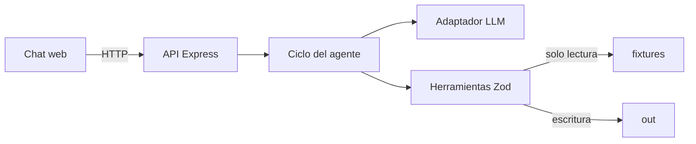

# Solución

## 1. Problema

La analista administrativa pierde tiempo y asume riesgo de error al transcribir repetidamente datos de proveedor y localizar soportes para formatos variables.

## 2. Arquitectura

El comportamiento vive en `agent/prompt.md`, el conocimiento en `src/knowledge/registro-proveedor.md` y la ejecución determinista en `src/tools/proveedor.ts`. El servidor no contiene reglas de mapeo.

## 3. Ciclo del agente

El backend guarda sesiones en memoria. Por turno envía mensajes y contratos al modelo, valida cada llamada con Zod, ejecuta herramientas y devuelve sus resultados hasta que haya texto final o alcance `MAX_ITERATIONS`. `MAX_SESSION_TOKENS` limita el consumo acumulado. Las llamadas son visibles en el chat y se registran en `out/log.jsonl` y en el log del caso.

La simulación de envío tiene doble barrera: el runtime rechaza llamadas espontáneas del modelo y solo ejecuta la herramienta si el turno anterior dejó confirmación pendiente y el siguiente mensaje es una confirmación inequívoca. No existe envío real.

## 4. Elección del modelo

Se eligió OpenCode Go con `minimax-m3`, que utiliza el protocolo compatible con Anthropic Messages y permite reutilizar el adaptador sin cambiar el ciclo. El uso está sujeto a las cuotas, modelos y condiciones vigentes de la suscripción Go; se debe revisar el consumo real por caso en la cuenta, sin asumir una tarifa por token adicional.

## 5. Diseño para portal web

Usaría navegador controlado en modo asistido, no automatización ciega. El agente prepara valores y soportes; el humano abre el portal, ingresa credenciales desde un gestor corporativo, resuelve CAPTCHA/MFA, revisa y pulsa “Enviar”. Las credenciales no entran al prompt, repositorio ni logs. Selectores se mantienen como configuración versionada y cualquier cambio de layout detiene la ejecución para revisión. Una extensión local sería preferible si el portal restringe navegadores automatizados; RPA centralizado solo si existen cuentas de servicio y controles de auditoría.

## 6. Decisiones y trade-offs

1. **Herramientas deterministas sobre extracción con LLM:** se descartó dejar el mapeo al modelo porque compromete trazabilidad y repetibilidad.
2. **Frontend sin framework:** se descartó React para reducir instalación, superficie de fallo y tiempo; el estado requerido es pequeño.
3. **Sesiones en memoria:** se descartó base de datos por estar fuera de alcance; reiniciar borra conversaciones.
4. **PDF generado:** se descartó AcroForm porque los fixtures describen campos pero no incluyen un PDF editable.
5. **Fecha real de ejecución:** la vigencia se evalúa contra el reloj del sistema, por lo que resultados históricos pueden cambiar correctamente.

## 7. Supuestos

- Las rutas y etiquetas de los fixtures son el contrato de entrada.
- El NIT colombiano puede proponerse para un identificador extranjero, pero siempre requiere confirmación.
- Un soporte sin `vigencia_hasta` no vence.
- “Enviar” en el reto significa exclusivamente crear `ENVIO-SIMULADO.md`.

## 8. Cobertura

| Historia | Estado | Pendiente de producción |
|---|---|---|
| HU-1 Leer solicitud | Hecho | Ingesta real de correo y archivos binarios |
| HU-2 Mapear campos | Hecho | Gobierno del maestro y glosario |
| HU-3 Generar formatos | Hecho | Preservar plantillas binarias reales |
| HU-4 Armar paquete | Hecho | Firma y gestor documental reales |
| HU-5 Errores | Hecho | Observabilidad y alertas centralizadas |

## 9. Uso de IA

Se utilizó PERXIA para analizar el PRD, estructurar la solución, implementar TypeScript, diseñar el chat y proponer pruebas. Se verificaron sus propuestas ejecutando demo, pruebas, lint y typecheck. Se descartaron dependencias de frontend innecesarias, automatización real de portales y cualquier aproximación donde el modelo inventara mapeos. La documentación vigente del SDK se consultó antes de implementar el adaptador.

## 10. Riesgos y mitigaciones

- **Dato maestro incorrecto:** propiedad formal del dato, versionado y revisión periódica.
- **Prompt injection en correo:** tratar fixtures como datos y limitar capacidades a herramientas cerradas.
- **Gasto de API pública:** autenticación, rate limiting, cuotas y límites ya configurables.
- **Sesiones perdidas:** persistencia cifrada con retención definida si pasa a producción.
- **Plantillas complejas:** parser aislado por formato, pruebas doradas y revisión humana.
- **Datos sensibles en logs:** resúmenes sin valores y política de redacción antes de observabilidad externa.
